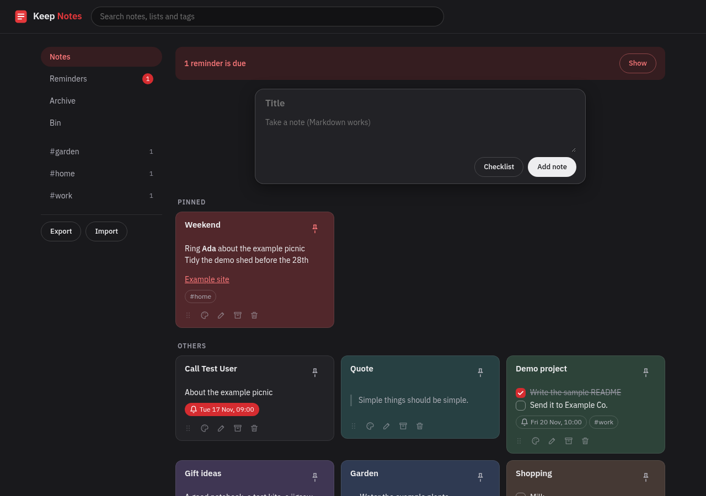

<div align="center">

# Starfire Notes

**Your own free take on Google Keep. Notes and checklists with pins, colours, tags, search, an archive, a bin and reminders, kept in one SQLite file on your own server.**

[](https://www.python.org/)
[](https://flask.palletsprojects.com/)
[](https://sqlite.org/)
[](LICENSE)

</div>



---

## Overview

Starfire Notes is a small self-hosted web app for notes and to-do lists. It has
its own sign-in for one owner account, so a copy runs on its own. It can
also sit behind a sign-in proxy: the author runs it behind the starfire
sign-in like SpotMP3 and VideoDL, where Caddy checks the sign-in, then
passes the request to Starfire Notes on `127.0.0.1`.

- **Notes** with a title and a Markdown body (bold, lists, links, code,
  quotes, tables). Raw HTML is shown as text, never run.
- **Checklists**: tick items off straight from the note card.
- **Pin** notes to the top, give them one of 11 **colours**, add **tags**.
- **Search** titles, text, checklist items and tags.
- **Archive** notes you want to keep out of the way.
- **Bin**: binned notes can be restored, and are deleted for good after 30 days.
- **Reminders** shown in the app: a badge and banner when one is due, and a
  Reminders view sorted by time. No email or push notifications.
- **Drag to reorder** with the mouse or a finger (the dotted handle), or the
  arrow keys on the handle.
- **Export and import** everything as one JSON file.
- Works on a phone: one column, views and tags in a row at the top.

---

## Requirements

- Python 3.11+

---

## Install and run on your own machine

```bash
git clone <this repo> keep-notes
cd keep-notes
python3 -m venv .venv
.venv/bin/pip install -r requirements.txt
cp .env.example .env
.venv/bin/python -m keepnotes
```

Then open `http://127.0.0.1:8097` and make the owner account (see below).
Notes are stored in `./data`.

`AUTH_MODE=local` switches the sign-in off for a copy only you use on this
machine: it then refuses to listen on anything but `127.0.0.1`, `::1` or
`localhost`.

---

## First run and sign-in

Starfire Notes has its own sign-in, switched on by default (`AUTH_MODE=builtin`).
There is one owner account and no sign-up page.

1. Start it (`.venv/bin/python -m keepnotes`) and open
   `http://127.0.0.1:8097`. With no account yet every page goes to
   **Set up**.
2. The app writes a one-time setup code to its log when it starts, a line
   like `no owner account yet: open /setup and enter the setup code ...`.
   Enter that code, a user name and a password (10 characters or more,
   twice). The code stops anyone else who reaches the page first from
   making the account, and it works once: if the owner file is ever
   deleted, the next visit to **Set up** writes a new code to the log.
3. After that, every page goes to **Sign in** until you sign in. A session
   lasts 30 days. `/signout` signs out on every device.

How it is protected:

- The password is stored as an scrypt hash in `DATA_DIR/owner.json`
  (mode 600), never in plain text.
- 5 wrong passwords or setup codes from one address within 15 minutes lock
  that address out for the rest of the 15 minutes (`429`). Attempts sent
  at once are counted before they are checked, IPv6 addresses count by
  their `/64` network, and after 100 failures from everywhere within 15
  minutes each address gets one try and each network three (IPv4 by `/24`,
  IPv6 by `/48`). A right password from a locked address is refused too.
- During such an attack one wrong password from a neighbour on the same
  provider network does not keep your new browser out: that takes three
  wrong passwords within 15 minutes from three of their addresses (IPv4)
  or three of their home lines (IPv6, where a line's whole `/56` counts as
  one address).
- A browser that has signed in before keeps a signed device cookie and has
  its own 5 tries, so a stranger who locks out your address (or the
  address of the proxy in front) cannot lock you out of that browser.
  During an attack from many networks that browser is the way in.
  Making a new owner account ends every device cookie of the old one.
- The session cookie is `HttpOnly`, `SameSite=Lax` and signed with the app's
  secret key. It is `Secure` everywhere except plain `http` on `localhost`,
  `127.0.0.1` or `[::1]` (`SECURE_COOKIES=auto`). On a plain `http` address
  on your home network the browser drops a `Secure` cookie and the sign-in
  page says so: use https, or set `SECURE_COOKIES=false` there.
- Forget the password? Stop the app, delete `DATA_DIR/owner.json`, start it
  again and set up a new owner with the new setup code from the log. Your
  data stays.

Behind a reverse proxy for https, with the own sign-in still on: list the
proxy's address in `TRUSTED_PROXIES` so the lockout counts each visitor's
address from `X-Forwarded-For` instead of the proxy's (the header is read
only from those addresses), and put the public host name in
`ALLOWED_HOSTS`. By default the own sign-in answers only on `localhost`,
`127.0.0.1`, `[::1]`, IP addresses and this machine's own name; any other
`Host` gets `421`, so a web page cannot reach a copy on your machine by
DNS rebinding.

To run it behind a sign-in proxy instead, set `AUTH_MODE=proxy` and list the
proxy's address in `TRUSTED_PROXIES`. The user header is then believed only
from those addresses; in the default mode it is never read.

---

## Configuration (`.env` or environment)

| Key | Description |
|---|---|
| `AUTH_MODE` | `builtin` (default): the app's own sign-in, one owner account. `proxy`: trust the user header from a sign-in proxy listed in `TRUSTED_PROXIES`. `local`: no sign-in, loopback only, and only for the host names `localhost`, `127.0.0.1` and `[::1]` with `PORT` (any other `Host` gets 421, so a web page cannot reach the app by DNS rebinding). |
| `BIND_HOST` / `PORT` | Where the app listens. Default `127.0.0.1:8097`. |
| `DATA_DIR` | Database (`keep-notes.db`), the owner account (`owner.json`) and the secret key (`secret_key`). Default `./data`. |
| `TRUSTED_PROXIES` | Addresses or networks whose user header is believed in `proxy` mode, comma separated. No default: `proxy` mode refuses to start without it. A network with host bits set (`10.0.0.5/8`) or one that reaches public addresses (`0.0.0.0/0`, `::/0`) stops the app at start-up; a single public address is allowed. In `builtin` mode, the proxies whose `X-Forwarded-For` gives the visitor's address to the lockout. |
| `ALLOWED_HOSTS` | In `builtin` mode, the only host names the app answers on, comma separated (others get 421). Empty: `localhost`, `127.0.0.1`, `[::1]`, IP addresses and this machine's own name. |
| `SECURE_COOKIES` | `auto` (default): the session cookie is `Secure` except on plain `http` to `localhost`, `127.0.0.1` or `[::1]`. `true` or `false` force it. Only used in `builtin` mode. |
| `USER_HEADER` | The header the proxy fills in. Default `X-Forwarded-User`. |
| `ALLOWED_USERS` | Optional comma separated list; any other user header value is refused. |
| `LOCAL_USER` | The user name shown in `local` mode. Default `local`. |
| `SECRET_KEY` | Optional. Without it a random key is made once in `DATA_DIR/secret_key` (mode 600). A key shorter than 32 bytes stops the app at start-up. |

---

## How sign-in and writes are protected

- In `builtin` mode (the default) a request is signed in only with the
  owner's session cookie; see [First run and sign-in](#first-run-and-sign-in).
  A user header is never read.
- In `proxy` mode a request is only signed in when it comes from an address
  in `TRUSTED_PROXIES` **and** carries a non-empty `USER_HEADER`. The same
  header sent from anywhere else is ignored and the request gets `401`.
  Every page and API call needs it except `/api/health`.
- The Caddy block in `deploy/` removes any `X-Forwarded-User` the visitor
  sends, checks the starfire session with `forward_auth` against
  `/api/auth/users` (the admin account only), and then sets
  `X-Forwarded-User` itself, to `SIGNED_IN_USER` from `deploy/site.env`.
  `ALLOWED_USERS` in the server env file is set to the same name and makes
  Starfire Notes refuse anything else.
- Every write (`POST`, `PATCH`, `DELETE`) needs the `X-CSRF-Token` header
  from `/api/session`, an HMAC of the user made with the secret key. A write
  whose `Origin` is a different host is refused too.
- Pages ship a strict Content Security Policy (scripts, styles, fonts and
  images from the app itself only), `X-Frame-Options: DENY`, `nosniff` and
  `no-referrer`. API answers are `no-store`.
- Markdown is rendered on the server with raw HTML switched off, images
  switched off (so a note cannot load a tracking pixel) and links limited to
  `http`, `https` and `mailto`, opening in a new tab without a referrer.
- All SQL is parameterised. Requests are capped at 10 MB.

---

## Export, import and backup

**Export** (the Export button, or on the server, where the app only believes
the header from `127.0.0.1` and only for the user in `ALLOWED_USERS`; `-f`
makes curl fail instead of saving a refusal as the file):

```bash
curl -f -H 'X-Forwarded-User: admin' -o keep-notes.json http://127.0.0.1:8097/api/export
```

The file holds every note, including archived and binned ones, with items,
tags, reminders and dates. **Import** (the Import button) adds the notes in
a file to the ones already there; it never replaces or deletes anything,
and a file with any bad note is refused as a whole.

**Backup of the database.** SQLite's online backup makes a consistent copy
even mid-write. On the server, run it as root; the copy itself runs as the
service user, because opening the database while the app is stopped creates
`-wal` and `-shm` files, and if root made them the app could no longer write:

```bash
copy_dir="$(mktemp -d)" && chown keep-notes:keep-notes "$copy_dir"
runuser -u keep-notes -- python3 -I - /var/lib/keep-notes/keep-notes.db "$copy_dir/copy.db" <<'PY'
import sqlite3, sys
source = sqlite3.connect(f"file:{sys.argv[1]}?mode=ro", uri=True)
copy = sqlite3.connect(sys.argv[2])
source.backup(copy)
copy.close()
source.close()
PY
mv "$copy_dir/copy.db" /root/keep-notes-$(date +%F).db && rmdir "$copy_dir"
```

**Restore** (server commands, untested on the server; the same copy was
checked locally by starting the app on it): stop the app, put the copy in
place as `keep-notes.db`, give it back to the service user, start the app:

```bash
systemctl stop keep-notes
install -m 600 -o keep-notes -g keep-notes /root/keep-notes-2026-11-13.db /var/lib/keep-notes/keep-notes.db
rm -f /var/lib/keep-notes/keep-notes.db-wal /var/lib/keep-notes/keep-notes.db-shm
systemctl start keep-notes
```

---

## Deploy behind starfire

> **UNTESTED.** `deploy.sh` and this section were written without touching
> the live server. Read the script before running it.

On that server Starfire Notes trusts the gate instead of its own sign-in:
`deploy/keep-notes.env` sets `AUTH_MODE=proxy` and
`TRUSTED_PROXIES=127.0.0.1,::1` (Caddy on the same machine).

`deploy.sh` installs Starfire Notes into a Proxmox container that already runs
Caddy and the starfire sign-in, reached with `ssh` and `pct`. The values for
your own setup live in `deploy/site.env`, which git ignores. Copy
`deploy/site.env.example` and fill it in:

| Key | Description |
|---|---|
| `PROXMOX` | The ssh host name of the Proxmox machine. |
| `CT` | The number of the container that runs Caddy. |
| `SITE_HOST` | The host name Starfire Notes is served on, like `keep.example.com`. |
| `SIGNED_IN_USER` | The starfire admin account name; Caddy passes it on and it becomes `ALLOWED_USERS`. |

What it sets up, matching SpotMP3:

| Piece | Where |
|---|---|
| Code and venv | `/opt/keep-notes` (root owned) |
| Notes | `/var/lib/keep-notes` (user `keep-notes`, mode 700) |
| Settings | `/etc/keep-notes/keep-notes.env` (root:keep-notes 640), from `deploy/keep-notes.env` |
| Service | `keep-notes.service` from `deploy/keep-notes.service`, on `127.0.0.1` at `PORT` from the env file (8097 by default), sandboxed, `MemoryMax=256M` |
| Sign-in page | `/srv/signin/keep`, built by `deploy.sh` with the sign-in page builder in `SITE_SIGNIN` |
| Caddy | the `http://SITE_HOST` block from `deploy/Caddyfile.keep-notes`, added once between the lines `# >>> keep-notes block, ...` and `# <<< keep-notes block`, with the port and the values from `deploy/site.env` filled in |

From your own machine:

```bash
./deploy.sh backup          # Caddyfile, any earlier install and a copy of the notes into /root in the container
./deploy.sh apply           # install HEAD, start the service, add the Caddy block, then check
./deploy.sh check           # read the "check failures:" line, 0 is good
```

`apply` refuses to run before `backup` and refuses if another program already
listens on the port. The port has one source: `PORT=` in
`/etc/keep-notes/keep-notes.env` in the container (on a first install, `deploy/keep-notes.env`
from the repo, which then becomes that file). The Caddy block is filled in from
it, so moving the app to another port means changing that one line and running
`apply` again, which rewrites the marked block. An existing env file is kept.
The Caddyfile is checked with `caddy validate` before every reload and put back
if it does not validate, and the sha256 of every deployed file is compared with
the commit. If `systemctl reload caddy` fails, the Caddyfile is put back too,
so a block Caddy never loaded is never left on disk. With Starfire Notes already
running, a `PORT` that another program listens on is refused as well (the
listener's process must be the keep-notes service's own). `check` also fails when
the marked block sends to another port than `PORT`. Each `apply` and `undo`
keeps the three newest of each kind of leftover (earlier and undone code in
`/opt`, earlier and undone sign-in pages in `/srv/signin`, Caddyfile copies
in `/etc/caddy`) and removes older ones; the database backups in `/root`
are never removed. Running `apply` again later updates the code in place and
keeps the notes.

`./deploy.sh undo` puts back what the last `apply` changed: the earlier code
and sign-in page, or after a first install it stops and removes the service.
Every `apply` first forgets what the one before it did, so after an `apply`
that failed before changing anything (pip could not install, the port was
taken) `undo` says there is nothing to undo, and after an `apply` that failed
its health check it puts back only the code. A second `undo` also says there
is nothing to undo. `undo` never changes `/etc/keep-notes/keep-notes.env`; when the
Caddy block it puts back sends to another port than `PORT` there, it says so
and `check` fails until the two agree. In the Caddyfile it
takes out only the marked keep-notes block (or puts back that block's earlier
version if `apply` had rewritten it), validates, reloads, and puts the file
back if it does not validate. The other apps' blocks and any edits made since
stay as they are. A `SITE_HOST` block that was there before `apply` is
never touched. Notes in `/var/lib/keep-notes`
are never touched.

Steps by hand:

1. In Cloudflare Zero Trust, add a public hostname for `SITE_HOST` to the
   tunnel, pointing at port 80 of the Caddy container.
2. Sign in once at `https://SITE_HOST` with the starfire admin account.
3. Optionally add a Kuma monitor for `http://127.0.0.1:8097/api/health` in the container.

---

## API

All paths need a signed-in session (in `proxy` mode, the signed-in user
header) except `/api/health` and the sign-in pages; writes also need
`X-CSRF-Token`.

| Method | Path | Purpose |
|---|---|---|
| GET | `/api/health` | `{"ok": true}`, or `503` when the database cannot be read |
| GET | `/api/session` | Signed-in user and CSRF token |
| GET | `/api/notes?view=notes\|archive\|bin\|reminders&q=&tag=` | List notes, plus the count of due reminders |
| POST | `/api/notes` | New note: `kind`, `title`, `body`, `items`, `color`, `pinned`, `archived`, `tags`, `reminderAt` |
| GET | `/api/notes/<id>` | One note |
| PATCH | `/api/notes/<id>` | Change any of the fields above |
| PATCH | `/api/notes/<id>/items/<item id>` | `{"checked": true}` ticks one item |
| POST | `/api/notes/<id>/trash` | Move to the bin |
| POST | `/api/notes/<id>/restore` | Take out of the bin |
| DELETE | `/api/notes/<id>` | Delete for good (only from the bin) |
| POST | `/api/notes/reorder` | `{"ids": [...]}` in the new order |
| GET | `/api/tags` | Tags in use with their counts |
| POST | `/api/bin/empty` | Delete every binned note |
| GET | `/api/export` | Download everything as JSON |
| POST | `/api/import` | Add the notes from an export |

`reminderAt` is an ISO 8601 time with a time zone, for example
`2027-01-31T09:00:00Z`; send `null` to clear it.

---

## Tests

```bash
.venv/bin/pip install -r requirements-dev.txt
.venv/bin/python -m pytest -q
```

---

## Tech

- Flask served by waitress, SQLite in WAL mode.
- markdown-it-py for Markdown, with HTML and images off.
- Plain HTML, CSS and JavaScript: no build step. The look and the colour
  tokens come from starfire, with the IBM Plex fonts bundled.

---

## Android app

`android/` holds a small Android app (Kotlin, one WebView) that opens your
Starfire Notes server full screen. The first time it opens it asks for your
server address, checks that the server answers, and remembers it. Change it
later from the long-press menu on the app icon ("Change address") or from the
link on the offline page. The app needs Android 10 or newer and asks only for
the internet permission.

Release builds are signed with `~/.starfire-keep-release.jks` (password in
`~/.starfire-keep-release.pass`), or with `STARFIRE_KEYSTORE`,
`STARFIRE_KEYSTORE_PASSWORD` and `STARFIRE_KEY_ALIAS` when those are set.
Without a release key the build stops; add `-PallowDebugSigning` to sign with
the debug key instead.

```bash
cd android
./gradlew testPublicDebugUnitTest
./gradlew assemblePublicRelease
```

The APK is `app/build/outputs/apk/public/release/app-public-release.apk`. To
build a private edition with your address built in and the setup screen
skipped, copy `android/private-address.example.properties` to
`android/private-address.properties` (git-ignored) and run `./gradlew
assemblePrivateRelease`.

### Security notes

- Only https addresses are accepted, with a full host name and no user name or
  password in them. Plain http is refused, even on a home network.
- Only your server's host (plus any extra hosts you add on the setup screen)
  opens inside the app. Every other link opens in the browser.
- If sign-in sends you to another host, add that host as an extra host, or the
  app shows a blank page and the browser opens.
- Downloads send your session cookie only when the download address is one of
  your hosts. Android's download manager repeats request headers on redirects,
  so keep download redirects on your own hosts.
- Files the page creates itself (blob: downloads) are sent to the app over a
  message channel that only accepts your own origins and the main frame. Each
  download gets an id from the app, is sent in acknowledged chunks, and is
  saved into Downloads through MediaStore with no storage permission. Each
  file is limited to 200 MB, a download that is incomplete, goes quiet for a
  minute, or is interrupted by leaving the page is deleted, and the app says
  it could not save it.
- The app adds no JavaScript interface object. The only page-to-app channel is
  the message listener for blob: downloads described above. The app never
  accepts a bad TLS certificate (it shows the offline page instead) and keeps
  backups off.

---

## License

MIT, see [LICENSE](LICENSE). The IBM Plex fonts are under the SIL Open Font License
(`keepnotes/static/fonts/LICENSE-ibm-plex.txt`).
